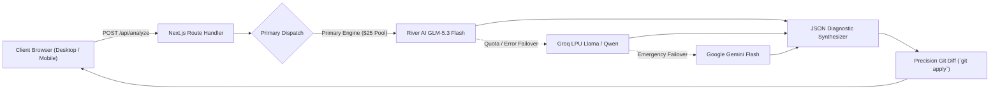

# ⚡ TraceLens AI

> **Turn raw stack traces into instant fixes & Git diffs in milliseconds.**  
> Full-Stack Next.js 14 (App Router) + TypeScript + Tailwind CSS developer tool with Serverless AI Route Handlers.

[](https://vercel.com/new/clone?repository-url=https%3A%2F%2Fgithub.com%2FAhmad-glowex%2Ftracelens-ai)
[](https://opensource.org/licenses/MIT)
[](https://nextjs.org)
[](https://river.ai)
[](https://groq.com)
[](#)

---

## 🚀 Overview

Developers spend countless hours parsing cryptic terminal crashes, segmentation faults, unhandled promise rejections, and Docker exit codes.

**TraceLens AI** is an intelligent full-stack developer workbench and triage assistant that:
1. **Serverless AI Route Handlers (`app/api/analyze/route.ts`):** Zero browser CORS issues. Secure, unified backend proxying to AI foundation models.
2. **Primary Engine — River AI GLM-5.3 Flash:** Powered by dedicated $25 credit pool for high-throughput reasoning and instant triage.
3. **Automated Cascading Failover:** If primary quotas exhaust, seamlessly falls back to Groq LPUs (`qwen/qwen3.8-27b`, `llama-3.3-70b-versatile`) and Google Gemini Flash (`gemini-2.0-flash`).
4. **Isolates Offending Frames:** Slices noisy framework stacks down to the exact root-cause user code line.
5. **Generates Precision Git Diffs:** Outputs syntactically valid unified Git diff patches (`git apply` compatible).
6. **Responsive Silicon Valley UI:** Side-by-side workbench for desktop and segmented mobile tab switcher with dark glassmorphism.

---

## 🛠️ Key Features

- **🌐 Serverless AI Architecture:** Clean `POST /api/analyze` route handling multi-provider AI synthesis with automated failover.
- **🎁 100% Free During Public Beta:** Unlimited terminal error analysis with zero paywalls and no credit card required.
- **🎯 Instant Root-Cause Analysis:** Pinpoint the exact runtime reason behind obscure errors (Node.js, TypeScript, Python FastAPI, Go panics, Rust bounds, Docker OOM 137).
- **⚡ Interactive Mobile & Desktop Workbench:** Tabbed navigation on mobile phones, split-screen on desktop with real-time character/line counters.
- **📋 1-Click Patch Application:** Copy formatted unified diffs ready for `git apply patch.diff` with instant toast notification.
- **✨ Silicon Valley Dark Aesthetic:** Engineered with Raycast / Linear aesthetic (Tailwind CSS, glassmorphism, JetBrains Mono typography, Lucide icons).

---

## 📐 Architecture & Failover Cascade



---

## 🚀 Deploy to Vercel (1-Click)

The repository is built strictly for Next.js 14 and can be deployed directly to Vercel with zero configuration:

1. Click the button below or go to [vercel.com/new](https://vercel.com/new):  
   [](https://vercel.com/new/clone?repository-url=https%3A%2F%2Fgithub.com%2FAhmad-glowex%2Ftracelens-ai)
2. Import the `Ahmad-glowex/tracelens-ai` repository.
3. (Optional) Set `RIVER_API_KEY`, `GROQ_API_KEY`, or `GEMINI_API_KEY` in Environment Variables.
4. Click **Deploy**.

---

## 💻 Local Development

```bash
# Clone repository
git clone https://github.com/Ahmad-glowex/tracelens-ai.git
cd tracelens-ai

# Install dependencies
npm install

# Start development server
npm run dev
```

Visit `http://localhost:3000` in your browser.

---

## 📄 Legal & Operator Notice

© 2026 TraceLens. All rights reserved. Operated by Raihan LLC (1910 Thomes Ave, Cheyenne, WY 82001, United States).

- [Terms of Service](https://github.com/Ahmad-glowex/tracelens-ai/blob/main/terms)
- [Privacy Policy](https://github.com/Ahmad-glowex/tracelens-ai/blob/main/privacy)
