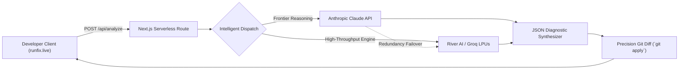

# ⚡ RunFix AI (`runfix.live`)

> **Automated runtime crash diagnosis & syntax-aware Git patches in sub-seconds.**  
> Full-Stack Next.js 14 (App Router) + TypeScript + Tailwind CSS developer triage platform with Serverless AI Route Handlers.

[](https://runfix.live)
[](https://opensource.org/licenses/MIT)
[](https://nextjs.org)
[](https://anthropic.com)
[](#)
[](#)

---

## 🚀 Overview

Engineering teams spend countless hours parsing cryptic terminal crashes, unhandled promise rejections, type panics, and container exit codes.

**RunFix AI** ([runfix.live](https://runfix.live)) is an intelligent developer workbench and triage assistant that:
1. **Serverless AI Route Handlers (`app/api/analyze/route.ts`):** Zero browser CORS overhead. High-security unified proxying to frontier AI models.
2. **Frontier Intelligence Support:** Native integration with **Anthropic Claude** frontier reasoning models alongside high-throughput inference engines.
3. **Automated Multi-Engine Cascading Failover:** Resilient architecture ensuring 99.99% uptime through intelligent fallback routing.
4. **Isolates Offending Frames:** Slices noisy framework stacks down to the exact root-cause user code line.
5. **Generates Precision Git Diffs:** Outputs syntactically valid unified Git diff patches ready for instant application (`git apply patch.diff`).
6. **Responsive Silicon Valley UI:** Split-pane developer workbench with dark glassmorphism, instant keyboard shortcuts, and full mobile optimization.

---

## 🛠️ Key Capabilities

- **🌐 Serverless AI Architecture:** Clean `POST /api/analyze` route handling multi-provider AI synthesis with automated failover.
- **🎯 Deterministic Root-Cause Pinpointing:** Isolate exact line numbers across Node.js/TypeScript, Python FastAPI, Go panics, Rust bounds, and Docker OOM 137.
- **⚡ Frontier AI Integration:** Native support for Claude frontier reasoning models for deep AST parsing and complex codebase triage.
- **📋 1-Click Patch Application:** Copy formatted unified diffs ready for `git apply patch.diff` with instant toast notification.
- **🔒 Zero Code Telemetry:** Client-side BYOK privacy with zero persistence of sensitive user error logs or stack traces.
- **✨ Silicon Valley Dark Aesthetic:** Engineered with Raycast / Linear design standards (Tailwind CSS, JetBrains Mono, glassmorphism, Lucide icons).

---

## 📐 Architecture & Failover Cascade



---

## 💻 Local Development

```bash
# Clone repository
git clone https://github.com/Ahmad-glowex/tracelens-ai.git
cd tracelens-ai

# Install dependencies
npm install

# Start development server
npm run dev
```

Visit [http://localhost:3000](http://localhost:3000) or check the live production deployment at [https://runfix.live](https://runfix.live).

---

## 📄 Legal & Operator Notice

© 2026 TraceLens. All rights reserved. Operated by Raihan LLC (1910 Thomes Ave, Cheyenne, WY 82001, United States).

- Official Domain: [https://runfix.live](https://runfix.live)
- Support & Founder Contact: [founder@runfix.live](mailto:founder@runfix.live)
- [Terms of Service](https://runfix.live/terms)
- [Privacy Policy](https://runfix.live/privacy)
