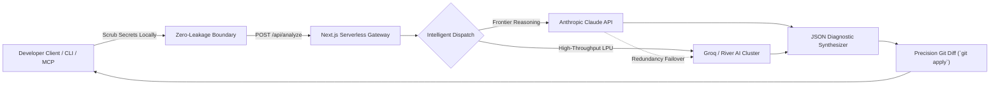

# ⚡ RunFix AI (`runfix.live`)

> **Autonomous runtime crash triage, client-side secret scrubbing, CLI & MCP server, and syntax-aware Git patches in sub-seconds.**  
> Full-Stack Next.js 14 (App Router) + TypeScript + Tailwind CSS developer triage platform with Serverless AI Route Handlers and CLI tooling.

[](https://runfix.live)
[](https://www.npmjs.com/package/runfix)
[](https://opensource.org/licenses/MIT)
[](https://nextjs.org)
[](https://modelcontextprotocol.io)
[](https://anthropic.com)
[](#)
[](https://runfix.live/security)

---

## 🚀 Overview

Engineering teams spend countless hours parsing cryptic terminal crashes, unhandled promise rejections, type panics, and container exit codes.

**RunFix AI** ([runfix.live](https://runfix.live)) is an autonomous developer triage assistant and developer workbench that:
1. **Wraps Any Command (`npx runfix`):** Monitors test suites, compilers, and builds (`npm test`, `pytest`, `cargo test`). Automatically captures crash logs on non-zero exit codes and returns a verified Git patch.
2. **Model Context Protocol (MCP) Server (`npx runfix mcp`):** Native JSON-RPC 2.0 stdio MCP server for Cursor, Windsurf, Claude Desktop, and VS Code.
3. **Client-Side Secret & PII Scrubber:** Synchronously redacts OpenAI, Anthropic, Google keys, GitHub PATs, AWS credentials, JWT Bearer tokens, DB connection strings, and emails before network dispatch.
4. **Autonomous CI Healer (`runfix-action.yml`):** GitHub Action that intercepts failed workflow runs and automatically generates a pull request with the synthesized patch.
5. **Frontier Intelligence Support:** Native integration with **Anthropic Claude** frontier reasoning models alongside high-throughput inference engines (Groq LPUs, River AI, Google Gemini).
6. **Multi-Engine Cascading Failover:** Resilient architecture ensuring 99.99% uptime through intelligent fallback routing.
7. **Isolates Offending Frames:** Slices noisy framework stacks down to the exact root-cause user code line.
8. **Generates Precision Git Diffs:** Outputs syntactically valid unified Git diff patches ready for instant application (`git apply patch.diff`).

---

## ⚡ Quickstart

### 1. Interactive Web Workbench
Visit [https://runfix.live](https://runfix.live) to paste error stack traces and synthesize instant patches in the browser.

### 2. Official Terminal CLI
Execute commands directly through `npx runfix` without global installation:

```bash
# Monitor command execution and auto-triage failures:
npx runfix "npm test"
npx runfix "pytest tests/"
npx runfix "cargo build"

# Pipe error log or stack trace:
cat trace.log | npx runfix
git log -1 --stat | npx runfix
```

### 3. Model Context Protocol (MCP) Server
Launch the MCP server to give your IDE autonomous error triage tools:

```bash
npx runfix mcp
```

Add to your **Claude Desktop** (`claude_desktop_config.json`) or **Cursor** (`.cursor/mcp.json`):

```json
{
  "mcpServers": {
    "runfix": {
      "command": "npx",
      "args": ["-y", "runfix", "mcp"],
      "env": {
        "RUNFIX_API_URL": "https://runfix.live/api/analyze"
      }
    }
  }
}
```

### 4. Autonomous GitHub Action Healer
Drop `templates/runfix-action.yml` into `.github/workflows/runfix.yml` in your repository. When your CI workflow fails, RunFix automatically fetches the failed log, generates a unified diff, and submits a pull request for review.

---

## 🛠️ Key Capabilities

- **🌐 Serverless AI Gateway (`POST /api/analyze`):** Secure server-side multi-provider routing with zero CORS friction.
- **🛡️ Client-Side Secret Scrubber:** Browser-side and CLI regex engine redacting sensitive keys before network transit.
- **🎯 Deterministic Root-Cause Pinpointing:** Isolate exact line numbers across Node.js/TypeScript, Python FastAPI, Go panics, Rust bounds check panics, and Docker OOM 137.
- **⚡ Frontier AI Integration:** Native support for Claude frontier reasoning models for deep AST parsing and complex codebase triage.
- **📋 1-Click Patch Application:** Copy formatted unified diffs ready for `git apply patch.diff` with instant toast notification.
- **🔒 Zero Code Telemetry:** Zero persistent caching of user code or crash logs. BYOK keys stay in client-side localStorage.
- **✨ Silicon Valley Dark Aesthetic:** Engineered with Raycast / Linear design standards (Tailwind CSS, JetBrains Mono, glassmorphism, Lucide icons).

---

## 📐 Architecture & Failover Cascade



---

## 🛡️ Enterprise Security & Zero Data Retention

- **Zero Persistence:** Error logs and generated diffs exist in volatile RAM only for the duration of the request.
- **Client-Side Secret Redaction:** API keys, database connection strings, JWTs, and email addresses are wiped prior to transmission.
- **BYOK Governance:** Bring Your Own Key (BYOK) stores keys strictly in browser `localStorage`.
- **Compliance & Auditing:** View the full security whitepaper and architectural guarantees at [https://runfix.live/security](https://runfix.live/security).

---

## 💳 Commercial Tiers & Roadmap

| Feature | Developer Free | Pro (BYOK) | Enterprise Healer |
| :--- | :---: | :---: | :---: |
| **Price** | **$0 / mo** | **$19 / seat / mo** | **$99 / seat / mo** |
| Interactive Web Workbench | ✅ | ✅ | ✅ |
| Community Rate-Limited AI | ✅ | ✅ | ✅ |
| Client-Side Secret Scrubber | ✅ | ✅ | ✅ |
| Terminal CLI (`npx runfix`) | ✅ | ✅ | ✅ |
| MCP Server (Cursor / Claude) | ❌ | ✅ | ✅ |
| Bring Your Own Key (BYOK) | ❌ | ✅ (0% markup) | ✅ |
| Autonomous CI Healer Action | ❌ | ❌ | ✅ |
| Multi-Repo Pull Requests | ❌ | ❌ | ✅ |
| Zero Data Retention SLA | Best Effort | Standard | Strict Enterprise SLA |
| Dedicated VPC / Gateway | ❌ | ❌ | Available |

Explore complete pricing details at [https://runfix.live/pricing](https://runfix.live/pricing).

---

## 💻 Local Development

```bash
# 1. Clone repository
git clone https://github.com/Ahmad-glowex/tracelens-ai.git
cd tracelens-ai

# 2. Install dependencies
npm install

# 3. Start development server
npm run dev

# 4. Run CLI locally
node bin/runfix.mjs --help
```

Visit [http://localhost:3000](http://localhost:3000) or check the live production deployment at [https://runfix.live](https://runfix.live).

---

## 📄 Legal & Operator Notice

© 2026 RunFix AI. All rights reserved. Operated by Raihan LLC (1910 Thomes Ave, Cheyenne, WY 82001, United States).

- Official Domain: [https://runfix.live](https://runfix.live)
- Developer Documentation: [https://runfix.live/docs](https://runfix.live/docs)
- Commercial Pricing: [https://runfix.live/pricing](https://runfix.live/pricing)
- Security Inquiries: [security@runfix.live](mailto:security@runfix.live)
- Support & Founder Contact: [founder@runfix.live](mailto:founder@runfix.live)
- [Terms of Service](https://runfix.live/terms)
- [Privacy Policy](https://runfix.live/privacy)
