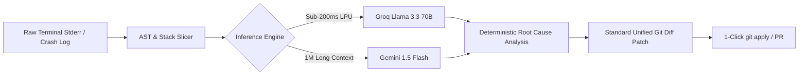

# ⚡ TraceLens AI

> **Turn raw stack traces into instant fixes & Git diffs in milliseconds.**  
> A 100% zero-budget, high-velocity developer productivity tool powered by Groq (Llama 3.3 70B) and Google Gemini 1.5 Flash.

[](https://opensource.org/licenses/MIT)
[](https://groq.com)
[](https://aistudio.google.com)
[](#)
[](#privacy)

---

## 🚀 Overview

Developers spend countless hours parsing cryptic terminal crashes, segmentation faults, unhandled promise rejections, and Docker exit codes.

**TraceLens AI** is an intelligent developer workbench and triage assistant that:
1. **Isolates Culprit Frames:** Slices noisy framework stacks down to the exact root-cause user code line.
2. **Generates Precision Git Diffs:** Outputs syntactically valid unified Git diff patches (`git apply` compatible).
3. **Sub-Second Latency:** Powered by Groq's high-throughput LPU inference (~300-800 tok/s) and Gemini 1.5 Flash.
4. **100% Client-Side Privacy (BYOK):** No backend telemetry. Your code and API keys never touch proprietary intermediary servers.

---

## 🛠️ Key Features

- **🎯 Instant Root-Cause Analysis:** Pinpoint the exact runtime reason behind obscure errors (Node.js, TypeScript, Python FastAPI, Go panics, Docker OOM 137).
- **⚡ Interactive Split-Screen Sandbox:** Test stack traces live with preset samples or custom terminal inputs.
- **🛡️ Bring Your Own Key (BYOK):** Seamlessly plug in free Groq or Gemini API keys, stored solely in your browser's local storage.
- **📋 1-Click Patch Application:** Copy formatted unified diffs ready for `git apply patch.diff` or GitHub PR creation.
- **✨ Silicon Valley Dark Aesthetic:** Engineered with Raycast / Linear aesthetic (Tailwind CSS, glassmorphism, JetBrains Mono typography, Lucide icons).

---

## 📐 Architecture & Flow



---

## ⚡ Quickstart (Local Run)

Since TraceLens AI is engineered as an ultra-fast, zero-overhead client application, you can run it immediately with zero complex build steps:

### Option 1: Python HTTP Server
```bash
# Clone the repository
git clone https://github.com/Ahmad-glowex/tracelens-ai.git
cd tracelens-ai

# Start local server
python3 -m http.server 3000
```
Then visit `http://localhost:3000` in your web browser.

### Option 2: Node.js (npx serve)
```bash
npx serve .
```

---

## 🌐 Deploy to GitHub Pages (100% Free)

To make TraceLens AI live publicly on your GitHub profile:
1. Go to your repository on GitHub: **`https://github.com/Ahmad-glowex/tracelens-ai`**
2. Click **Settings** &rarr; **Pages** (under Code and automation).
3. Under **Branch**, select `main` and root folder `/ (root)`, then click **Save**.
4. Within 60 seconds, your site is live at:  
   👉 **`https://ahmad-glowex.github.io/tracelens-ai/`**

---

## 🚀 Deploy to Vercel (1-Click)

1. Go to [vercel.com/new](https://vercel.com/new).
2. Import the `Ahmad-glowex/tracelens-ai` repository.
3. Keep default settings and click **Deploy**.

---

## 📄 Legal & Operator Notice

© 2026 TraceLens. All rights reserved. Operated by **Raihan LLC** (1910 Thomes Ave, Cheyenne, WY 82001, United States).

- [Terms of Service](terms.html)
- [Privacy Policy](privacy.html)
